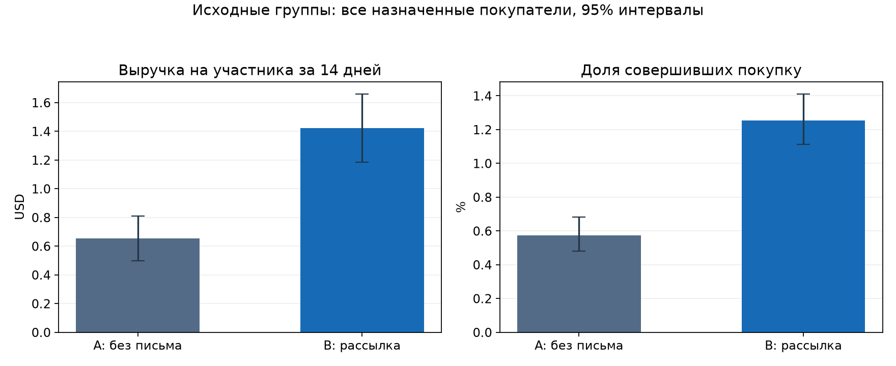
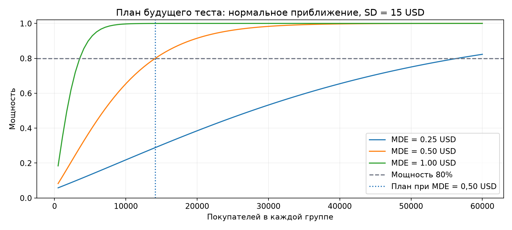
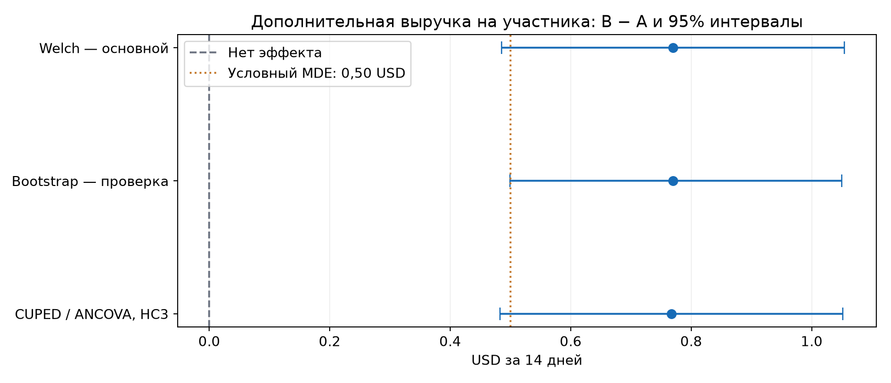
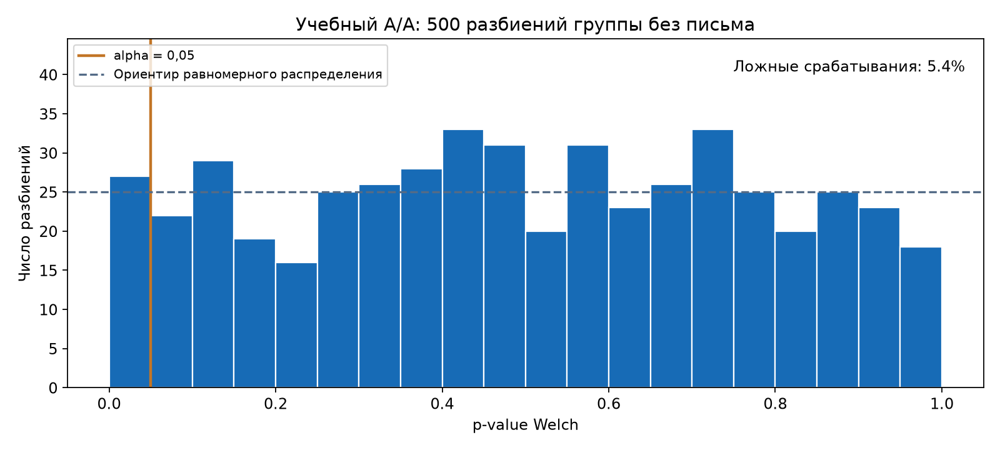

# Приносит ли рассылка дополнительную выручку?

## Решение

По основной метрике есть статистические свидетельства роста выручки от рассылки. Прибыльность и допустимость масштабирования требуют данных о затратах, марже и негативной реакции клиентов.

Выручка на назначенного покупателя выросла на **0.770 USD** (+117.9% к контролю); 95% CI **[0.485; 1.055] USD**, Welch p-value = **1.1638e-07**. Это эффект письма с товарами мужской коллекции против отсутствия письма за 14 дней в историческом эксперименте, без переноса на другую аудиторию.

95% интервал включает эффекты ниже условного MDE: превышение бизнес-порога не установлено, даже если точечная оценка больше него.

## Данные и группы

[Hillstrom / MineThatData](https://blog.minethatdata.com/2008/03/minethatdata-e-mail-analytics-and-data.html), 2008 год. Использованы 42,613 строк из 64,000. Владелец данных описывает случайное назначение. Исходные группы не пересоздаются; `Womens E-Mail` исключена заранее по плану, а не по результатам. Название рассылки не обозначает пол участника.

| Группа | Участников | Выручка на участника, USD | Купили за 14 дней | Посетили сайт |
| --- | ---: | ---: | ---: | ---: |
| A: No E-Mail | 21,306 | 0.653 | 0.573% | 10.62% |
| B: Mens E-Mail | 21,307 | 1.423 | 1.253% | 18.28% |

Единица анализа — покупатель. Считаем всех назначенных, включая нулевые траты; средний чек только среди купивших не заменяет основную метрику. В исходном файле нет настоящего user_id: `record_id` — номер строки снимка для воспроизводимости. Нельзя независимо проверить повторное участие одного человека. Одинаковые строки признаков не удалены автоматически.

SHA-256 CSV: `0e5893329d8b93cefecc571777672028290ab69865718020c78c7284f291aece`. Проверены схема, 64 000 строк, отсутствие пропусков/нечисловых значений, бинарные индикаторы и неотрицательные траты. Технические диагностики: 6562 полностью одинаковых строк исходных признаков; 0 несовпадений признака покупки с положительными тратами. Исходный файл сохранён без изменений.

SRM для выбранных A/B-групп при ожидаемом 1:1: p = 0.9961; диагностический порог = 0.001. Это проверка размеров, а не доказательство корректности назначения. Баланс предэкспериментальных признаков дан в `pre_experiment_balance.csv` через standardized mean difference без перебора p-value.

## План аналогичного будущего эксперимента

Основная гипотеза H0: средняя выручка B − A равна нулю. Альтернатива двусторонняя; alpha = 5%, power = 80%. При учебных допущениях SD = 15 USD и MDE = 0.50 USD нужны **14,129 покупателей на группу**, **28,258 всего**. Эти допущения записаны до анализа результатов и не выдаются за измеренные параметры компании. Расчёт t-test power предполагает общий SD; для реального запуска его нужно оценить на независимой истории и проверить достаточность выборки при распределении выручки с большим числом нулей.

Для дополнительного примера конверсии 1% → 1.3% (+0.3 п.п.) нужны 19,744 участников на группу при тех же alpha/power. Это отдельный сценарий дизайна, не замена основной метрики. Таблица чувствительности к MDE и SD сохранена в `sample_size_sensitivity.csv`.

Нужно набрать выборку и дождаться полных 14 дней для последнего включённого покупателя. Длительность набора без данных о трафике неизвестна. Досрочная остановка по ежедневному p-value не предусмотрена. Наблюдаемая мощность по найденному эффекту не рассчитывается. Исторический эксперимент был проведён автором; здесь разработан план аналогичного теста.

## t-test, Mann–Whitney и bootstrap

- **Основной метод:** Welch t-test для разницы средних, без предположения равных дисперсий. Нули и крупные покупки не исключаются.
- **Mann–Whitney:** p = 1.582e-13; U/(nA × nB) = 0.50340. Использована асимптотическая поправка на совпадающие ранги. Этот результат касается рангов/распределений, а не размера средней дополнительной выручки. Метод не выбран вместо Welch по величине p-value.
- **Bootstrap:** 3000 перевыборок покупателей отдельно внутри каждой группы; 95% percentile CI разницы средних [0.499; 1.050] USD. Это дополнительная оценка неопределённости, без выбора удобного интервала.
- Конверсия и посещения — вторичные описательные метрики. Их интервалы в таблицах точечные, без коррекции множественных сравнений; решение по ним отдельно не принимается.

## CUPED / ковариатная корректировка

Ковариата `history` — сумма покупок за год до эксперимента. Использована регрессия `spend ~ treatment + centered_history` с HC3-ошибками. Её treatment-коэффициент равен разнице средних после вычитания общей линейной зависимости от предыстории (CUPED / ANCOVA). Оценка theta учитывается через регрессионный расчёт неопределённости; постэкспериментальные `visit`, `conversion` и `spend` не могут выступать ковариатами.

Эффект после корректировки: 0.767 USD; 95% CI [0.483; 1.052], p = 1.2478e-07. Корреляция history и spend: 0.0209; уменьшение объединённой внутригрупповой дисперсии: 0.04%. Эффект метода на этих данных измерен, а не обещан заранее. Исходный Welch остаётся основным анализом.

## Учебный A/A и сплит с солью

Внутри исходного `No E-Mail` выполнен детерминированный SHA-256-сплит с солью `aa-demo-v1`: A = 10,545, B = 10,761, Welch p = 0.0825. Ни одна из этих групп письма не получала. Соль не подбиралась под p-value. Этот сплит не заменяет исходное A/B-назначение и не выдаётся за live A/A.

В 500 дополнительных случайных разбиениях контроля получено 27 p-value ниже 0.05: частота 5.4%, 95% Wilson CI [3.7%; 7.7%]. Это калибровочная диагностика на эмпирическом распределении контроля; она не доказывает контроль ошибки первого рода при любых распределениях и не проверяет исходную систему назначения компании. Все повторения сохранены в `aa_pvalues.csv`.

## Продуктовая интерпретация и ограничения

Разница с контрольной группой оценивает дополнительные покупки относительно органического поведения, а не приписывает письму всю выручку получателей. Для вывода о прибыли нужны маржа, стоимость контакта и сопутствующие расходы. При условной марже m прирост вклада на контакт оценивается как `m × дополнительная выручка − стоимость контакта`; параметры в данных отсутствуют.

Отписок, жалоб, возвратов и долгосрочного удержания нет. Их следует добавить как защитные метрики нового запуска. Из архива нельзя подтвердить фактическую доставку письма или отсутствие иных воздействий; анализ следует исходному назначению. Вывод относится к двухнедельному окну и этой аудитории. План анализа создан сейчас для повторного исследования, он не был регистрацией до исторического запуска 2008 года.

## Формулировка для анкеты

«Проанализировал реальный рандомизированный эксперимент с CRM-рассылкой: сравнил 42,613 покупателей в тесте и контроле, оценил дополнительную выручку на участника с помощью Welch t-test и bootstrap, применил Mann–Whitney с отдельной интерпретацией. Рассчитал выборку для аналогичного будущего эксперимента, проверил SRM и баланс предыстории, реализовал учебный A/A и CUPED-корректировку. Эффект по выручке составил 0.77 USD на участника за 14 дней, 95% CI [0.49; 1.05]; описал ограничения масштабирования».
